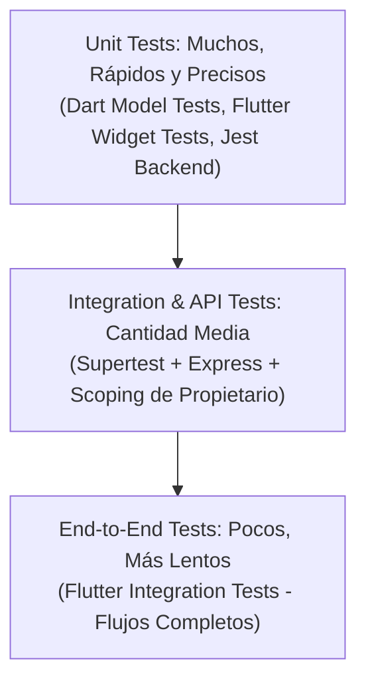

# 1. Mentalidad de Tester y Plan de Pruebas

## Objetivo
Investigar el comportamiento del sistema de manera sistemática en lugar de simplemente confirmar que "la aplicación funciona".

---

## Pirámide de Pruebas (Mermaid Diagram)

---

## Ejercicio Práctico (Sección 1)

### Requerimiento Seleccionado:
**"Un usuario autenticado puede crear una nueva tarea en su cuenta."**

### Criterios de Aceptación (Acceptance Criteria):

1. **Éxito típico (Typical Success):**
   - **Dado** que un usuario ha iniciado sesión con credenciales válidas y se encuentra en la pantalla de tareas,
   - **Cuando** presiona el botón "Agregar tarea", ingresa un título válido (ej. `"Revisar flujo de despliegue"`) y presiona "Guardar",
   - **Entonces** la tarea se persiste en la base de datos asociada a su `ownerId`, aparece inmediatamente en la lista de tareas del usuario y el diálogo se cierra.

2. **Entrada inválida (Invalid Input):**
   - **Dado** que el usuario abre el diálogo de creación de tarea,
   - **Cuando** ingresa una cadena vacía o una cadena compuesta únicamente por espacios en blanco (`"   "`), o supera los 120 caracteres permitidos, y presiona "Guardar",
   - **Entonces** el sistema bloquea el guardado, no realiza petición errónea al servidor o el backend responde con código `400 Bad Request`, y la interfaz muestra el mensaje de error: `"Enter a valid title."` o `"Title must be 120 characters or fewer."`.

3. **Límite de permisos / Frontera de autorización (Permission Boundary):**
   - **Dado** que un usuario atacante (Usuario B) conoce el ID de una tarea creada por el Usuario A,
   - **Cuando** el Usuario B intenta consultar o modificar dicha tarea mediante una petición a la API (`/api/v1/tasks/:id`) usando su propio token JWT,
   - **Entonces** el servidor rechaza la solicitud retornando `403 Forbidden` o `404 Not Found` (política uniforme para no divulgar la existencia de recursos ajenos), y en ningún caso muestra los datos de la tarea del Usuario A al Usuario B.
